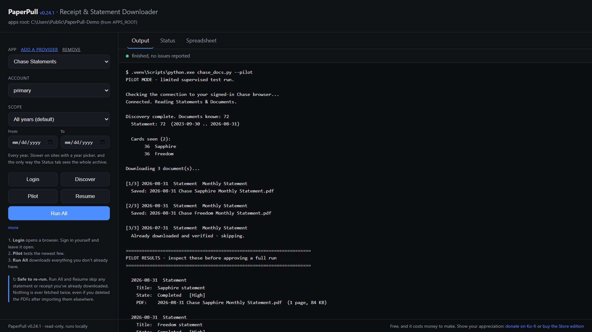
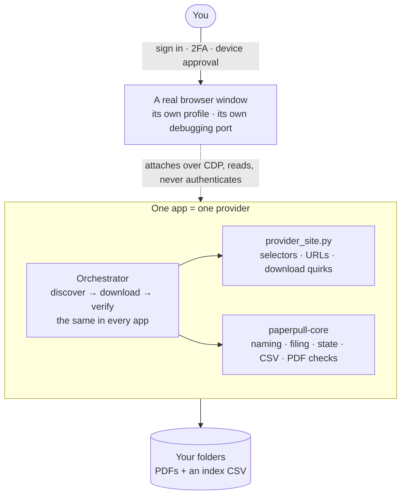
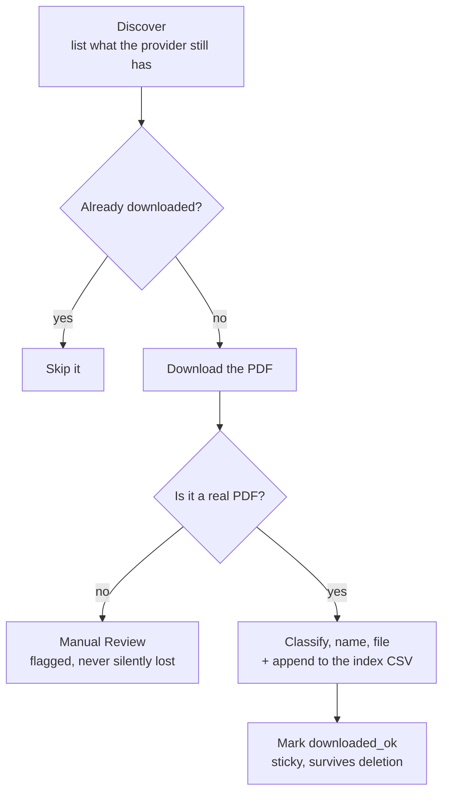

# PaperPull


[](#paperpull-server)
[](https://github.com/sponsors/rheeloaded)
[](https://ko-fi.com/rheeloaded)
[](https://paperpull.net)

**Collect years of statements and receipts. Skip the endless downloading.**

PaperPull retrieves the statement and receipt history your banks, cards,
stores and utilities already hold, organizes it as PDFs on your own
computer or a server at home, and turns your purchases and transactions
into spreadsheets. You sign in yourself, typing your password and
answering the two-factor prompt in a real browser window. From there
PaperPull **only downloads**. It never pays a bill, moves money or changes
a setting (see [how that is enforced](#read-only-by-construction)). Free and
open source, no account, no cloud. Made for archiving (into
[paperless-ngx](https://docs.paperless-ngx.com/) or a folder of your own)
instead of clicking through each site by hand.

**On your computer, or on a server at home.** The desktop app runs on
Windows and macOS. **[PaperPull Server](#paperpull-server)** is the
same app as one Docker image, for a NAS or home server beside
Paperless-ngx. You use it from a browser on any computer in the house,
sign in to each provider on a browser screen it shows you, and each run's
new documents can go straight into Paperless. Both are free.



**Watch it:** a [77-second demo](https://youtu.be/TfeOMngCgLM) on the real panel with made-up accounts. **Website:** [paperpull.net](https://paperpull.net), with the [getting-started guide](https://paperpull.net/guide.html), the [provider directory](https://paperpull.net/providers.html), the [Paperless-ngx tutorial](https://paperpull.net/paperless.html) and the [FAQ](https://paperpull.net/faq.html) (the most asked questions are also [below](#faq)). **Download:** the [latest release](https://github.com/rheeloaded/paperpull/releases/latest), Windows 10 or 11 and macOS on Apple Silicon or Intel, Linux from source. **Self-hosting** takes the Docker image `ghcr.io/rheeloaded/paperpull-server` and [three steps](#paperpull-server).

**It also turns those PDFs into spreadsheets.** Your receipts become one
long table of every item you have ever bought, across every store and every
account, with what it cost and when. The transactions inside your bank and
card statements are read out of the PDFs into a workbook, one row each, and
every statement is checked against its own printed balances, so a row you
are looking at is a row that adds up. One button on the control panel, or
one command. See [Every purchase in one spreadsheet](#every-purchase-in-one-spreadsheet)
and [The transactions inside your statements](#the-transactions-inside-your-statements).

Runs on **Windows and macOS** (and Linux), with the same commands on each,
and **self-hosted** on a NAS or home server with Docker.

**PaperPull is free, and it costs money to make.** There is a server and
domains to keep paid, developer accounts for the signed Mac build and the
Microsoft Store, the tools it is built with, and evenings on every provider
to build it and to keep it working as sites change. If it saves you time, you can show your
appreciation and support future development by
**[sponsoring on GitHub](https://github.com/sponsors/rheeloaded)** or
**[donating on Ko-fi](https://ko-fi.com/rheeloaded)**, or by buying the
**[Microsoft Store edition](https://apps.microsoft.com/detail/9P5LZRR773FP)** for $9.99, one time, the same program with a
signed installer and automatic updates. Or download it free from the
[Releases page](https://github.com/rheeloaded/paperpull/releases). Nothing
is held back from the free build. See [Support](#support).

Seventy-one providers are supported today, all built on the same pattern.
Seven more, SBA, Verizon Mobile,
Meijer, American Family, Stripe, FedEx and Bank of America, are built and waiting for someone with an account to
test them ([#28](https://github.com/rheeloaded/paperpull/issues/28),
[#31](https://github.com/rheeloaded/paperpull/issues/31),
[#42](https://github.com/rheeloaded/paperpull/issues/42),
[#45](https://github.com/rheeloaded/paperpull/issues/45),
[#53](https://github.com/rheeloaded/paperpull/issues/53),
[#54](https://github.com/rheeloaded/paperpull/issues/54),
[#121](https://github.com/rheeloaded/paperpull/issues/121)):

| App | Provider | Documents | Notes |
|-----|----------|-----------|-------|
| [`affirm`](apps/affirm) | Affirm | Loan agreements (Truth in Lending), one per loan | JSON API from inside the page, nothing clicked; no monthly statement exists for a pay-over-time account |
| [`adp`](apps/adp) | ADP Workforce Now | Pay statements, W-2s | Statement services from inside the page, nothing clicked but the tax statements' View statement that starts ADP's identity check, real Edge/Chrome. Requested in [#46](https://github.com/rheeloaded/paperpull/issues/46) |
| [`aafmaa`](apps/aafmaa) | AAFMAA (Armed Forces Mutual) | Annual statements, policy docs | ASP.NET WebForms; one documented disclosure dialog |
| [`ally`](apps/ally) | Ally Bank | Account statements, tax forms | JSON API; same-dated statements named from the PDF |
| [`alpaca`](apps/alpaca) | Alpaca | Brokerage and crypto statements, trade confirmations | **Contributed by [@JasperDale420](https://github.com/JasperDale420), 22 documents saved on a full run.** Each row's own Download pressed once, and only the download from the link the page hands that press is kept. A Paper account is never read |
| [`amazon`](apps/amazon) | Amazon (any country's store, `marketplace` setting) | Order invoices (full history) | Per-year order pagination |
| [`amfam`](apps/amfam) | American Family Insurance | Billing statements and any tax form listed with them | **Untested, built without an account. Have one? [Help test it](apps/amfam/README.md#help-test-it-no-programming-needed)** Being tested by [@jpfieber](https://github.com/jpfieber). |
| [`amex`](apps/amex) | American Express | Statements, Year-End Summary | Click-nav SPA; in-memory session |
| [`att`](apps/att) | AT&T (Mobility, Fiber, Internet) | Monthly bills | **Confirmed by [@watling777](https://github.com/watling777)** on two accounts, wireless and internet, with a full run on each ([#26](https://github.com/rheeloaded/paperpull/issues/26)) |
| [`anthem`](apps/anthem) | Anthem BCBS (Elevance, 14 Blue states) | EOBs, plan docs (all years), ID cards, letters | Health insurance (PHI); tRPC API, nothing clicked. Contributed by [@riordan](https://github.com/riordan) |
| [`apple`](apps/apple) | Apple (App Store and Apple Store) | App Store receipts for subscriptions, in-app purchases and paid apps, and Apple Store order invoices | **Built and run on the maintainer's own account.** Report a Problem's own purchase search from inside the page for the whole family, paid purchases only, each saved from Apple's own receipt, and the Apple Store's order list and invoices, nothing clicked, real Edge/Chrome |
| [`applecard`](apps/applecard) | Apple Card and Apple Savings | Apple Card statements, Savings statements, tax forms | **Confirmed by [@watling777](https://github.com/watling777)**, whose Pilot and full run saved every statement and the 1099-INT forms. Requested in [#52](https://github.com/rheeloaded/paperpull/issues/52) |
| [`bestbuy`](apps/bestbuy) | Best Buy | Online, store-order and in-store receipts, and returns | **Built on the maintainer's own account, 35 purchases back to 2015.** The history through the page's own query a year at a time, each details page saved as the receipt, nothing clicked but the year menu, real Edge/Chrome, paced for Best Buy's bot protection |
| [`bilt`](apps/bilt) | Bilt Card (serviced by Cardless) | Card statements | **Contributed by [@JasperDale420](https://github.com/JasperDale420), 8 statements saved on a full run.** Only the card's balance summary, View statements and a statement's own button are pressed, and the PDF is taken from the tab it opens |
| [`bofa`](apps/bofa) | Bank of America | Checking, savings and credit card statements | **Untested, built from a tester's two recordings, and its first two runs listed the statements and saved none. Have one? [Help test it](apps/bofa/README.md#help-test-it-no-programming-needed)** Statements & Documents' own list and PDF links, read from inside the page, with its Statements heading opened, and when the links have no address, one pressed to learn the page's own call for a PDF. Requested in [#121](https://github.com/rheeloaded/paperpull/issues/121) |
| [`capitalone`](apps/capitalone) | Capital One | Bank and card statements, tax forms, letters | Ported by [@davidrudnick](https://github.com/davidrudnick); fresh live pilot pending |
| [`chase`](apps/chase) | Chase (credit cards) | Card statements | Real Edge/Chrome; per-card accordions + year picker |
| [`chasebusiness`](apps/chasebusiness) | Chase Business (business document center) | Business checking and business card statements, up to seven years | **Contributed by [@JasperDale420](https://github.com/JasperDale420), 10 checking statements and the business card's first statement saved on full runs.** One profile so far, so a debit account's statements are untested. Seven kinds of control pressed through the guard, real Edge/Chrome |
| [`citi`](apps/citi) | Citi (credit cards) | Monthly card statements | Statements API from inside the page, nothing clicked; the site lists about two years online |
| [`coinbase`](apps/coinbase) | Coinbase | Monthly account statements, Coinbase One Card statements, tax forms, gain and loss reports | **Contributed by [@JasperDale420](https://github.com/JasperDale420), 66 statements and 2 tax documents saved on a full run.** Each month's own PDF button on the Statements page pressed once and the download taken only from Coinbase's statements bucket, and tax PDFs from the list calls the Taxes page makes, nothing pressed. One Card statements from the Credit Card tab, each row's own PDF button pressed once, 13 saved on a full run on one account |
| [`costco`](apps/costco) | Costco Wholesale | Receipts, in-warehouse, gas, pharmacy and costco.com orders | **Written from a member's recording and run against their account, 34 purchases back to July 2024** ([#47](https://github.com/rheeloaded/paperpull/issues/47)). Each receipt names its part of Costco, Warehouse or Gas Station, for a file name pattern ([#60](https://github.com/rheeloaded/paperpull/issues/60)). One membership so far, so a second Pilot is welcome. Two tabs, quarters walked, the warehouse receipt is a dialog rendered with printToPDF, real Edge/Chrome |
| [`discovercard`](apps/discovercard) | Discover (credit cards) | Card statements | Capital One is moving these accounts onto its own site. A card that has moved is read there by the [`capitalone`](apps/capitalone) app ([#13](https://github.com/rheeloaded/paperpull/issues/13)) |
| [`dominion`](apps/dominion) | Dominion Energy (VA) | Billing statements | Paginated MUI accordion; ~18-month limit |
| [`ebay`](apps/ebay) | eBay | Order receipts, ten years of purchase history | **Confirmed by [@jpfieber](https://github.com/jpfieber), every order back to 2017.** Order-details page rendered to PDF, nothing clicked but the order list's Show more, real Edge/Chrome. Requested in [#44](https://github.com/rheeloaded/paperpull/issues/44) |
| [`lowes`](apps/lowes) | Lowe's Home Improvement | Store and online receipts, and returns | **Built on the maintainer's own account.** The purchase history read by address, each purchase's details page saved as the receipt, nothing clicked, real Edge/Chrome |
| [`homedepot`](apps/homedepot) | The Home Depot | Order receipts, with model and store SKU numbers | **Built on the maintainer's own account.** The history through the page's own request, Home Depot's own print receipt taken without opening the print dialog, nothing clicked, real Edge/Chrome. Home Depot keeps two years online |
| [`etrade`](apps/etrade) | E*TRADE | Statements, trade confirmations, tax forms | **Confirmed by [@watling777](https://github.com/watling777)**, whose Pilot and full run saved every statement ([#36](https://github.com/rheeloaded/paperpull/issues/36)). No tax form seen yet |
| [`ezpassva`](apps/ezpassva) | E-ZPass Virginia | Monthly and quarterly toll statements | **Built on the maintainer's own account.** The portal's own statements list read from inside the page, nothing clicked; about a year is online, so run it at least once a year |
| [`fairfaxwater`](apps/fairfaxwater) | Fairfax Water (VA) | Water bills | Mendix portal, driven like a person; PDFs for the last year only, so run it quarterly |
| [`fedex`](apps/fedex) | FedEx Billing Online | Shipping invoices | **Untested, built from a login not connected to Billing Online. Use it? [Help test it](apps/fedex/README.md#help-test-it-no-programming-needed)** Requested in [#54](https://github.com/rheeloaded/paperpull/issues/54) |
| [`fidelity`](apps/fidelity) | Fidelity Investments | Statements, trade confirmations, tax forms | Document Access Hub API from inside the page, nothing clicked; real Edge/Chrome |
| [`invest529`](apps/invest529) | Invest529 (Virginia529 / Commonwealth Savers) | Official quarterly statements for every beneficiary and 1099-Q tax forms | **Built and run on the maintainer's own account, 38 documents across three beneficiaries saved on a full run.** Each read through the account's own API, nothing clicked |
| [`firsthorizon`](apps/firsthorizon) | First Horizon Bank | Checking statements, about two years online | **Contributed by [@JasperDale420](https://github.com/JasperDale420), 24 statements saved on a full run.** An account's panel and each statement's own Download PDF are the only presses. One checking account so far, so savings and card statements are untested |
| [`gap`](apps/gap) | Gap Inc. (Gap, Old Navy, Banana Republic, Athleta) | Order receipts | Lazy-loading history; ~13-month limit |
| [`irs`](apps/irs) | IRS (Individual Online Account) | Account, return, wage and income, and record of account transcripts | **Contributed by [@JasperDale420](https://github.com/JasperDale420), 26 transcripts saved on a full run, untested by others. Have an IRS Online Account? [Help test it](apps/irs/README.md#help-test-it-no-programming-needed)** Each transcript fetched by its own address, nothing clicked. Sign-in through ID.me is your own |
| [`kroger`](apps/kroger) | Kroger (Pick 'n Save, Metro Market, Fred Meyer, Ralphs and the rest) | Receipts, in-store, fuel, pickup and delivery | **Confirmed by [@jpfieber](https://github.com/jpfieber) on [#41](https://github.com/rheeloaded/paperpull/issues/41).** Each receipt names its banner, Metro Market or Fred Meyer, for a file name pattern. Purchase-history API and receipt page, nothing clicked, real Edge/Chrome |
| [`github`](apps/github) | GitHub | Payment receipts (Pro, Copilot, Actions, Sponsors and the rest) | **Confirmed by [@jpfieber](https://github.com/jpfieber) on [#43](https://github.com/rheeloaded/paperpull/issues/43).** Receipt links fetched or printed, nothing clicked |
| [`golden1`](apps/golden1) | Golden 1 Credit Union | Statements, tax forms | **Confirmed by [@watling777](https://github.com/watling777)**, whose run saved every statement on both of his accounts, a credit card's named as one ([#35](https://github.com/rheeloaded/paperpull/issues/35)) |
| [`ibkr`](apps/ibkr) | Interactive Brokers | Monthly Activity Statements | **Contributed by [@tylerverry](https://github.com/tylerverry), 60 of 61 months saved on a full run.** The Statements page's own Activity Statement dialog, Monthly chosen and each month's own Download PDF button pressed once, and nothing else is clicked. Regional hosts `.com`, `.co.uk` and `.ie` |
| [`meijer`](apps/meijer) | Meijer | Order receipts, in-store digital receipts where mPerks lists them | **Untested, built without an account. Have one? [Help test it](apps/meijer/README.md#help-test-it-no-programming-needed)** Being tested by [@jpfieber](https://github.com/jpfieber). Nothing clicked but its two tabs and an in-store receipt's own icon |
| [`myecp`](apps/myecp) | MILITARY STAR (Exchange Credit Program) | Card statements | **Built on the maintainer's own account, 25 statements back to 2023.** The MyECP statements list and download from inside the page, nothing clicked |
| [`mypay`](apps/mypay) | DFAS myPay | eRAS, CRSC, 1099-R, 1095 | Government pay system; JSON API, nothing clicked |
| [`mtb`](apps/mtb) | M&T Bank | Mortgage statements, escrow, 1098 | Own online banking; you list, app expands all years |
| [`netbenefits`](apps/netbenefits) | Fidelity NetBenefits (workplace 401(k)) | Quarterly or monthly statements, made to order | The site generates statements on request; the app requests each period and renders it, nothing clicked |
| [`navyfederal`](apps/navyfederal) | Navy Federal CU | Account statements | Per-account accordions; blob-tab PDFs |
| [`nelnet`](apps/nelnet) | Nelnet | Student loan statements, 1098-E, notices | **Contributed by [@tylerverry](https://github.com/tylerverry), 47 documents in one full run.** The inbox list, paged and read from the page, each statement taken from its own Download button. The 1098-E is the Tax Info page printed after its own year's button is pressed |
| [`newrez`](apps/newrez) | Newrez | Mortgage statements, escrow analysis, 1098 | **Confirmed by [@watling777](https://github.com/watling777)**, whose run saved every document, three years of statements through the statements page's year picker and the 1098s ([#38](https://github.com/rheeloaded/paperpull/issues/38)) |
| [`optum`](apps/optum) | Optum Bank (HSA) | HSA statements, 5498-SA and 1099-SA tax forms | **Contributed by [@JasperDale420](https://github.com/JasperDale420), 21 statements and the 5498-SA saved on a full run.** Every document a plain link on the member site, fetched by its own address, nothing clicked. One HSA so far, so more than one product is untested |
| [`paypal`](apps/paypal) | PayPal | Monthly statements | **Built on the maintainer's own account, 25 statements.** The site's own statements list and download from inside the page, nothing clicked for a personal account, and three years are online |
| [`nwnatural`](apps/nwnatural) | NW Natural (Oregon and Washington natural gas) | Monthly bills, the whole history the payment portal keeps | **Built and run on a contributor's own account, 84 bills listed and the newest saved by a Pilot.** Read from the Paymentus portal's Bill History and each bill's View address, from inside the tab you signed in with, nothing clicked. One account at a time |
| [`paylocity`](apps/paylocity) | Paylocity | **Pay statements** | Escher JSON API, enqueue-poll-fetch PDF; nothing clicked |
| [`pge`](apps/pge) | PG&E (Pacific Gas and Electric) | Billing statements | Salesforce portal with a paginated history. Contributed by [@appchamp](https://github.com/appchamp). Repaired in 0.37.1 and confirmed on a real account by [@watling777](https://github.com/watling777) ([#33](https://github.com/rheeloaded/paperpull/issues/33)) |
| [`redcard`](apps/redcard) | Target RedCard / Circle Card (TD Bank) | Billing statements | Statements table; per-year switcher |
| [`robinhood`](apps/robinhood) | Robinhood | Account statements, tax docs | "View More" pagination |
| [`sba`](apps/sba) | SBA (MySBA Loan Portal) | Loan statements, 1098 | **Untested, built without an account. Have an SBA loan? [Help test it](apps/sba/README.md#help-test-it-no-programming-needed)** |
| [`schwab`](apps/schwab) | Charles Schwab | Statements, tax forms, letters, trade confirmations | Ported by [@davidrudnick](https://github.com/davidrudnick); fresh live pilot pending |
| [`sdge`](apps/sdge) | SDG&E (San Diego Gas & Electric) | Monthly bills, about two years online | **Contributed by [@JasperDale420](https://github.com/JasperDale420), 8 bills saved on a full run.** Each bill fetched by its own address from Billing History, nothing clicked. One account per run, the one selected on the site |
| [`shelbycounty`](apps/shelbycounty) | Shelby County Trustee (Memphis, TN) | Property tax receipts, one per payment, and the current tax notice while a balance is due | **Contributed by [@JasperDale420](https://github.com/JasperDale420), 17 receipts across 16 tax years saved on a full run.** A public lookup with no sign-in, the parcel ID goes in config.json. The page builds each PDF itself and the app keeps it, one guarded press per document |
| [`simmons`](apps/simmons) | Simmons Bank (Banno online banking) | Loan statements, notices, tax forms | **Contributed by [@JasperDale420](https://github.com/JasperDale420), 27 documents saved on a full run.** Only a document row's own button is pressed, and the download taken only when it is that document's own. One loan so far, so a sign-in with a second account stops the list. A paid-off loan's documents stay online only until a date the bank names |
| [`smud`](apps/smud) | SMUD (Sacramento Municipal Utility District) | Monthly bills | **Confirmed by [@watling777](https://github.com/watling777)**, whose Pilot took the newest five and whose full run took the rest of the history ([#34](https://github.com/rheeloaded/paperpull/issues/34)) |
| [`spectrum`](apps/spectrum) | Spectrum (Internet and Mobile) | Internet statements, about a year online, and Mobile statements printed from their pages | **Contributed by [@JasperDale420](https://github.com/JasperDale420), 11 Internet statements saved on a full run.** Mobile statements listed live, a whole Mobile run still to come. Each statement chosen by its own row. Two statements of one date, after an account transfer, are left for you to save by hand |
| [`stripe`](apps/stripe) | Stripe (merchant Dashboard) | Fee invoices, tax forms such as the 1099-K | **Untested, built on an account with no documents yet. Have Stripe invoices or tax forms? [Help test it](apps/stripe/README.md#help-test-it-no-programming-needed)** Requested in [#53](https://github.com/rheeloaded/paperpull/issues/53) |
| [`statefarm`](apps/statefarm) | State Farm | Bills, renewal notices, ID cards, receipts, policy documents | **Confirmed by [@watling777](https://github.com/watling777)**, whose full run saved every document State Farm lists for his policies ([#37](https://github.com/rheeloaded/paperpull/issues/37)) |
| [`target`](apps/target) | Target | Receipts (Online + In-Store) | Print-capture |
| [`tmobile`](apps/tmobile) | T-Mobile | Bill statements | Bill-history page; detailed-bill download |
| [`treasurydirect`](apps/treasurydirect) | TreasuryDirect (savings bonds and Treasuries) | Current Holdings, Security and Payment History, saved from its pages, taxable years listed for you | **Contributed by [@JasperDale420](https://github.com/JasperDale420), 3 documents saved on a full run, every PDF opened. 1099 pages unconfirmed. Have a taxable year? [Help test it](apps/treasurydirect/README.md#help-test-it-no-programming-needed)** Its own links pressed in your tab, pages rendered to PDF |
| [`tsp`](apps/tsp) | Thrift Savings Plan | Participant statements, 1099-R | Secure Mailbox API from inside the page, nothing clicked; downloading marks the message read |
| [`uber`](apps/uber) | Uber (rides and Uber Eats) | Ride receipts and Uber Eats order receipts | **Built and run on the maintainer's own account, 24 receipts.** The trip list and the Uber Eats order list from inside each signed-in page, Uber's own receipt PDF for each paid purchase, checked for its receipt ID, nothing clicked, real Edge/Chrome |
| [`ukg`](apps/ukg) | UKG Pro / UltiPro | **Pay statements** | Per-employer tenant; JSON-API, nothing clicked |
| [`ups`](apps/ups) | UPS Billing Center | Shipping invoices | **Built on the maintainer's own account.** The Billing Center's own invoice list and download from inside the page, nothing clicked |
| [`usaa`](apps/usaa) | USAA | Statements | JSON-API enumeration |
| [`usbank`](apps/usbank) | U.S. Bank | Credit-card statements | Ported by [@davidrudnick](https://github.com/davidrudnick); fresh live pilot pending |
| [`vanguard`](apps/vanguard) | Vanguard | Account statements | **Contributed by [@tylerverry](https://github.com/tylerverry), 135 statements across five accounts.** The statements page's own list, read while its year picker is walked, then each statement's own download control, pressed through the guard |
| [`venmo`](apps/venmo) | Venmo | Monthly account statements, printed from the Statements page | **Contributed by [@JasperDale420](https://github.com/JasperDale420), 24 months saved on a full run.** Reads two years unless you set a From date, and says so when older months may hold more. Show more is the only press, and a month is printed only once every transaction is drawn |
| [`verizon`](apps/verizon) | Verizon (Fios) | Bill statements | Real Edge (bot block); dropdown + CDP download |
| [`verizonmobile`](apps/verizonmobile) | Verizon Mobile (wireless) | Monthly bills | **Untested, built without an account. Have one? [Help test it](apps/verizonmobile/README.md#help-test-it-no-programming-needed)** |
| [`walmart`](apps/walmart) | Walmart | Receipts | Hardened against bot detection |
| [`wellsfargo`](apps/wellsfargo) | Wells Fargo | Account statements, tax documents | **Confirmed by [@appchamp](https://github.com/appchamp)** on a real account's credit card statements ([#27](https://github.com/rheeloaded/paperpull/issues/27)). Checking, savings, mortgage and tax documents are untested. Have one? [Help test it](apps/wellsfargo/README.md#help-test-it-no-programming-needed) |
| [`wealthfront`](apps/wealthfront) | Wealthfront | Statements, tax docs | |

> ⚠️ **Read this first:** these tools drive real, signed-in financial accounts.
> See [SECURITY.md](SECURITY.md) before you run *or* publish anything. In short:
> never commit your `*-browser-profile/` folder, your `config.json`, or any
> downloaded PDF. The `.gitignore` blocks them, don't override it.

## How it works (the shared design)

### The one decision everything follows from

Your documents live on the provider's site, and it will only hand them to a
browser that is already signed in. So PaperPull never tries to *be* you, it
works *beside* you. You sign in yourself, in a real browser window, and the
tool attaches to that window afterwards and reads.



That single choice is why there is no password anywhere in this project, why
2FA and device approvals are never an obstacle, and why a provider tightening
its login breaks nothing here.

In practice that first step is `paperpull <app> login` (or the app's own
`login.bat` / `login.command`), which opens the browser for you, a plain
Chromium for most apps, or your own installed Edge/Chrome for the few sites
whose bot detection turns a fresh Chromium away (Walmart, Verizon, Chase).
Each app gets its own profile and its own debugging port, so several
signed-in browsers can sit open at once without colliding. Those profiles
are separate from your everyday browser on purpose, so each starts with no
extensions and no saved logins. They are real browser profiles, though, so
a password manager installed into one, from the extension store in the
sign-in window, stays there for every later sign-in to that provider.
It is one profile per provider, so the extension goes in once for each
provider you set up, not once for all of them.

**Everything a provider knows lives in one file.** `provider_site.py` holds
every selector, URL and download quirk for that site. The orchestrator around
it is the same in every app, and `paperpull-core` underneath it is
shared. When a provider redesigns, the repair is one file, never a rewrite,
and never a change to how documents get named, filed or tracked.

### What one run actually does



Three plain-text files carry the state, and you can read all of them:

| File | Holds |
|------|-------|
| `discovery.json` | what the provider showed us this run |
| `progress.json` | what happened to each document, including the sticky `downloaded_ok` |
| `<Provider> Document Index.csv` | one row per saved document, for humans and spreadsheets (receipt apps also keep an `Order History.csv`, one row per line item). Text that starts like a formula, an item a seller named `=...` for one, is written with a `'` in front, so Excel opens it as text |

That last step is what makes a re-run safe. `downloaded_ok` is keyed to the
document, not to the file on disk, so you can import everything into
paperless-ngx, delete the PDFs, and the next run still skips them. It only
fetches what is genuinely new, and lists it in `new-this-run.txt`, which
Discover, Verify, Rename and a dry run leave as the last download run wrote
it. To fetch
them again anyway, open the provider in the control panel, choose
**Restore deleted files** under More and pick a year, or both a From and a
To date, or add `--redownload` to a run from a terminal. Nothing is
overwritten. A file still there stays as it is, and the app may save a
second copy beside it.

### Read-only by construction

Nothing that buys, sells, transfers, pays, deletes, or changes a setting is
ever clicked, and all site interaction lives in `provider_site.py` where it
can be read in one sitting. Every app carries a blocklist
(`FORBIDDEN_CONTROL_RE`) of the words such a control would use. Most apps that
press controls also decide which of the page's controls may be pressed with
`is_safe_control()`, so a control must clear the blocklist *and* match a
document allowlist (`SAFE_DOC_CONTROL_RE`), deny by default. The rest press
only controls they find by a selector or by words written in the app, and the
Target and Walmart apps check every receipt control against the blocklist,
since a document allowlist would refuse the paging they press. Many apps click
nothing at all during a run. They read the provider's pages by address, or the
same data the provider's own page asks for. Each app's host allowlist refuses
any stored URL that points elsewhere, and a repo-wide test checks every app's
guard. [SECURITY.md](SECURITY.md) spells out which app does which.

### One app, more than one person

In the control panel, **add a person** beside the Account box makes the
second person's account, and the Account box then runs every action against
it. From a terminal it is `paperpull <app> add-account spouse`, then
`paperpull <app> all --account spouse`. Either way it gets its own profile,
port and output folder beside the first one's, so no data mixes. Underneath it is a
`config.spouse.json` beside the app's `config.json`, which the app also takes
directly as `--config`, and the sign-in launcher takes the label too
(`login.bat spouse` / `./login.command spouse`). `python tools/add_account.py
spouse` does every app at once.

## PaperPull Server

PaperPull also runs on an always-on machine at home, a NAS or a home server
with Docker, next to [Paperless-ngx](https://docs.paperless-ngx.com/), and
is used from a browser on any computer on your home network. The panel is
the same, the providers' sign-in windows open on a browser screen the server
shows you, and each run's new documents can be copied straight into
Paperless's consume folder. You still sign in to each provider yourself, as
on the desktop.

| | Desktop app | PaperPull Server |
|---|---|---|
| Runs on | your Windows PC or Mac | a NAS or home server with Docker and an Intel or AMD processor |
| You use it from | its own window | a browser on any computer on your home network |
| Signing in | a browser window on your desktop | a browser screen the server shows in your browser |
| New documents | folders on your computer | folders on the server, and copied into Paperless-ngx's consume folder if you mount it |
| Who can reach it | only your computer | your home network, behind a password you choose |
| Updates | the next installer, or the Store | the new version in `compose.yaml`, then `docker compose pull` and `docker compose up -d` |
| Price | free, or the Store edition | free |

Getting it running takes three steps, and [SERVER.md](SERVER.md) has the
rest, Paperless, a NAS's own Docker screens, updates and backups.

1. Copy [`server/compose.yaml`](server/compose.yaml) and
   [`server/seccomp-chrome.json`](server/seccomp-chrome.json), or the two
   in `PaperPull-Server-X.Y.Z.zip` on the
   [newest release](https://github.com/rheeloaded/paperpull/releases/latest),
   into a folder on the server, and set `PUID`, `PGID`, `TZ` and the data
   folder in `compose.yaml`.
2. Start it. Docker downloads the image every release publishes,
   `ghcr.io/rheeloaded/paperpull-server`.
   ```bash
   docker compose up -d
   ```
3. Open `http://<the server's address>:8765` from a browser at home and
   choose a password, with the setup code the container prints in
   `docker logs paperpull`.

For HTTPS, the setup SERVER.md recommends, use `compose.https.yaml` with
`Caddyfile` beside it in place of `compose.yaml`, see
[HTTPS](SERVER.md#https).

It is made for a machine at home. A rented server works, but providers
treat data-center addresses as likely bots and check far more often. It
listens on your home network behind a password, so it has privacy and
security pages of its own, [PRIVACY-SERVER.md](PRIVACY-SERVER.md) and
[SECURITY-SERVER.md](SECURITY-SERVER.md). It is free, like the rest of
PaperPull.

## Quick start

These steps are for the desktop app. The server's are
[above](#paperpull-server).

**Want to see it first?** The panel's welcome screen offers **Open the
sample**, a folder of invented statements and receipts. The Accounts page
fills in and both spreadsheets build from it, so you can see exactly what
PaperPull produces before you sign in to anything. Nothing downloads while
you are in it, and *Leave the sample* puts you back. Every document in it
says on its face that it is invented.


**One-shot setup**, one Python environment that the control panel and every
app share, with the shared core in it.

```bat
setup-all.bat        REM Windows
```

```bash
./setup-all.command  # macOS / Linux
```

Then either drive everything from the **[GUI control panel](gui)**, which
lists every provider and person with what needs you, and gets new documents
with one button per account:

```bat
gui\run_gui.bat
```


…or run a single app from the terminal, with one command for all of them
(using `amex` as the example):

```bat
copy apps\amex\config.example.json apps\amex\config.json    REM then edit paths as needed
paperpull amex login            REM opens a browser, sign in yourself, leave it OPEN
paperpull amex pilot            REM download the newest few as a test
paperpull amex all              REM download everything available
paperpull amex resume           REM continue after an interruption
paperpull list                  REM every app it can see
```

`paperpull` is `paperpull.bat` on Windows and `./paperpull` on macOS and
Linux, or `python paperpull.py` anywhere. In the installed Mac app it is
`/Applications/PaperPull.app/Contents/Resources/paperpull`, and in the
installed Windows app it is `paperpull.bat` in the folder PaperPull was
installed to, `%LOCALAPPDATA%\PaperPull` unless you chose another. Both work
on the same installs the panel does. It finds the app by folder name,
slug or provider, runs it on the right Python, and passes anything else
straight through, so `paperpull chase all --year 2025 --account spouse` works.
The commands are `setup`, `login`, `discover`, `pilot`, `all`, `resume`,
`verify`, `diagnose` and `dry-run`. The panel names them for what they do.
Sign in, Get new documents, Try the newest few first and Only check what's
there sit on each provider's page, Continue appears after a run that
stopped, and the rest are under More, each with a line saying what it does.
A receipt provider's More also has **Review names**, for the receipts it
was unsure how to name.
Which dates (one year, or a date range) becomes the same `--year`,
`--start-date` and `--end-date` every app takes, and **Restore deleted
files** adds `--redownload` to one run scoped to a year or to both ends of
a range.

Each app also has its own README with provider-specific details and quirks.

The one environment setup-all builds is `gui/.venv`. An app can still have an
environment of its own, made by `paperpull <app> setup` or the app's own
`setup.bat` / `setup.command`, and an app with one runs on it. setup-all
used to make one in every app folder, about 400 MB each. To free that space
in an older checkout, run setup-all again, then delete the `.venv` folder
inside each app folder.

## Knowing when to run it again

`tools/status.py` reads the state each app already keeps and reports how current
every archive is. Copy it and `status.bat` next to your install folders and run
it. It downloads nothing and changes nothing. The control panel's Accounts
page shows the same, one row per provider and person, most in need first,
each with the button that fixes it.

```
PROVIDER                     DOCS  NEWEST          AGE  ISSUES     STATUS
Some Payroll                   12  2026-06-18     72 d  2x month   !! OVERDUE
A Bank                         97  2026-06-30     60 d  monthly    *  due
A Mortgage                     93  2026-07-31     29 d  monthly       current
A Shop                        667  2026-08-13     16 d  -             ongoing
```

It reports the archives you **have**. Nobody holds an account with every
provider, so a folder you never set up, or one left behind by a closed account,
is left out entirely rather than listed as missing or overdue. An archive that
was set up but never downloaded anything is called out by name, since that is
the one state a single run fixes.

It answers "is something new probably waiting" rather than "when did I last run
this", which are different questions. A run that only verified existing files
still updates a timestamp while telling you nothing about whether a new
statement exists. So the signal is the date of the newest document you actually
hold, measured against how often that provider issues them.

The cadence comes from your own history and is measured per account, so nothing
has to be configured, and a provider that moves from monthly to quarterly
corrects itself. Measuring per account matters: one bank folder can cover
several accounts, and pooling their dates makes a monthly cycle look weekly.
Receipt archives are shown without a due date, because purchases arrive
irregularly and "40 days overdue" would be noise.

### It also looks for holes in the middle

Being up to date is not the same as being complete. An archive can hold a
document from last week and still be missing whole years behind it, which is
exactly what happened twice while building this: one mortgage archive held a
single year of a seven year history, and a payroll archive quietly defaulted to
year to date. Both looked healthy by their newest document.

So each series is also checked for periods that look missing from the middle:

```
Possible gaps. A run that looks current can still be missing
periods in the middle, so these are worth a look.
  A Bank
     2025-03-18 to 2025-05-17   1 missing   3 series, including Savings
     2026-01-01 to 2026-04-02   2 missing   3 series, including Savings
```

The hard part is not finding gaps, it is not inventing them. Plenty of real
documents arrive irregularly, insurance ID cards and policy renewals among
them, where a long quiet stretch means nothing was issued rather than something
was missed. Flagging those would train you to ignore the report, so a series
has to earn an opinion first: at least six documents, a median interval of ten
days or more, and at least 65 percent of its intervals close to that median.
Only then is an interval roughly twice the usual one reported, and it is
reported as possible rather than certain.

Windows shared by several series are grouped, because one account missing a
month is usually a quiet month, while the same window missing across several at
once is what a run that failed part way looks like.

`--html` also writes a `status.html` dashboard you can bookmark, and `--quiet`
prints only what needs attention. The dashboard reads no document contents and
carries no amounts or account numbers, but it does list which providers you
hold accounts with, so it belongs with your installs and is gitignored here.

## Every purchase in one spreadsheet

The receipt apps (Amazon, Target, Walmart, Gap) record every line item they
see while downloading, in an `<Provider> Order History.csv` beside the PDFs.
`tools/export_purchases.py` gathers all of them into one workbook, one row
per item across every provider and account, newest first, with an Orders
sheet and a Summary of spend per provider per year. Amounts are numbers, so
Excel can sum them. Nothing reads a PDF and it takes about a second.

```
python tools/export_purchases.py --root "C:\path\to\your\installs"
```

The panel has the same thing on its **Spreadsheets** page, one button, with
a choice of one provider at a time (`Amazon Purchases.xlsx`). The file is
rebuilt from scratch each time, so edit a copy, not the original.

## The transactions inside your statements

A statement archive holds PDFs, and the transactions are inside them.
`tools/export_transactions.py` opens each PDF a statement archive's index
knows about, reads it line by line, and keeps the lines that have the shape
of a transaction, a date, a description and an amount. Nothing in it is
written for one bank. What makes it trustworthy is the statement itself.
Every statement prints a beginning and an ending balance, and the
transactions between them have to add up.

```
python tools/export_transactions.py --root "C:\path\to\your\installs"
```

Where the statement carries a running balance column, the sign of every
amount is read off the balance and the statement reconciles to the cent by
construction. Where it prints signed amounts, they are summed as printed and
checked against every balance pair the statement shows, which is how a card
statement that prints its summary three times is read right. A statement
covering two accounts is reconciled one account at a time. A statement that
does not add up is still exported, with the difference in the Statements
sheet, so you know which rows to doubt. On the author's archive, every USAA
and Navy Federal statement and 120 of 128 American Express statements
reconcile. Brokerage statements never will, since their balances include
market movement, and the sheet says so.

Amounts are the effect on the balance. Money in is positive, money out is
negative, for a bank account and a card alike. Each PDF is read once and
remembered in a cache beside the installs, so the first build of a big
archive takes minutes and the next takes seconds. The panel's Spreadsheets
page has this too, as Bank transactions, showing its progress.

## Naming your files your way

Files are named `2026-03-09 Target Coffee Receipt.pdf` unless you say
otherwise. The panel's **File names** page shows the name your newest file
would get, and builds it from parts you add, remove and move, the date in
the shape you like, the provider, the order or document number, the
account, the total and more, each shown with how many of your own files
carry it. A part can be skipped when a document does not have it, so no
name ends in a stray dash, and your newest files are shown under the new
pattern as you change it. The pattern can still be written by hand under
Edit as text.

A `/` in the pattern puts files in folders, inside the folder each kind of
document already goes to. `{provider}/{year}/{date:yyyy-mm-dd} {summary}`
files a Chase statement as
`Statements/Chase/2026/2026-03-09 Monthly Statement.pdf`. A folder whose
part is empty is left out, Manual Review stays one folder, and a pattern
goes at most three folders deep.

One pattern covers every receipts app or every statements app, or any
single app can have its own. After you save, the page offers to rename
the files you already have to match, a preview first and then the
rename, and nothing is downloaded again. Renaming moves files into the
folders a pattern names, and back out again if you change your mind. The
last run's `new-this-run.txt` is left as that run wrote it, so it names
each file as the run saved it, before the rename. A line can then name a
file that has another name now, or, when two files traded names, the
other file, and the list's second line says so. The pattern language is
in [docs/file-naming.md](docs/file-naming.md).

## A documents folder, for every provider or each person

Documents can go to a folder apart from the browser profiles, records and
logs in your PaperPull folder, such as one Google Drive or another sync
program keeps, one Paperless-ngx watches or a share on a NAS. In Settings,
under **Documents folder**, give one folder for every provider, and each
provider and person gets a folder of their own inside it, named as their
PaperPull folder is, such as `Chase Statements` and
`Costco Receipts - spouse`. Below it, pick a provider and person to give
them a folder of their own instead, or keep their documents in the
provider's own folder. One set that way keeps it when the folder for every
provider changes, and **Use the folder for every provider** sets it back.
The first save gives a folder in it to everyone whose config names no
documents folder, one set back to the provider's own folder in an earlier
version included, since that left no setting, so set those again below
after it.
The page lists each one that keeps a folder of their own, and **Use it for
every provider** gives all of them their folder inside it at once, a copy
of each config kept in the provider's Backups folder first.

Each download is still saved and checked in the provider's own folder, and
one that fails its check is put aside in its Manual Review there. When a
run from the panel ends, the documents it saved and checked move into the
documents folder, into Statements, Tax Documents, Receipts and the other
folders of each kind, with any folders your naming pattern adds. The
provider's records, Manual Review, Logs, Diagnostics and Backups never
move, so the documents folder only ever gets documents that passed their
checks. The run's `new-this-run.txt` stays in the provider's own folder and
lists what the run saved, each file where the run saved it, before the move.

Saving the setting moves nothing that is already there. Documents saved
before stay where they are, and PaperPull still finds them, so nothing is
downloaded again. The page says how many are still in the provider's
folder and offers **Preview move** and then **Move**, which moves each one
under the name it has, with its records following it, and puts everything
back if a record cannot be written. Change the folder or set it back, and
the same Move brings the documents to where it now points. A browser
profile, a folder inside or around one, a folder holding a provider's own
folder and a folder inside or around a person's own folder are refused. A
provider or person added later gets their folder inside the folder for
every provider as their first download run from the panel starts, and the
run says so. One whose config already names a documents folder, their own folder
included, is never changed by a run. The panel writes each one's folder
into their config.json as `"documents_dir"`, a full path, so a run from a
terminal uses it too, and from a terminal the move is a Rename run with
`PAPERPULL_MOVE_DOCUMENTS=1` in its environment. On PaperPull Server the
folder has to be inside the data folder, see
[SERVER.md](SERVER.md#paperless).

## Moving to another computer

The record of what each provider already downloaded is what keeps
PaperPull from downloading a document twice, and it can move with you. On
the old computer, press **Export history** in the panel's Settings. On
the new one, or on [PaperPull Server](SERVER.md#coming-from-the-desktop-app),
choose that file under **Moving from another computer?** on the welcome
page, or under **Import a history file** in Settings. Every provider
and person in it is set up with their settings, and nothing they already
downloaded is downloaded again. No sign-in or PDF travels in the file, so
you sign in to each provider once on the new machine. It does list
document titles, order numbers, totals and the account holders' names, so
keep it as private as your documents. From a terminal,
`python tools/migrate.py --export` and `--import` do the same for providers
already set up.

## Windows and macOS

**Both have a package.** Every release on the
[Releases page](https://github.com/rheeloaded/paperpull/releases) carries
`PaperPull-<version>-setup.exe` for Windows, which installs the control
panel, the shared core and every provider into your own user folder with no
admin rights and no Python on the machine, and `PaperPull-<version>.zip`, the
same folder for anyone who would rather not run an installer. The package
is x64 and runs on Windows on ARM (a Snapdragon laptop, say) under the
emulation Windows 11 provides, where the browser it drives is your own
native Edge or Chrome and the Python side spends its life waiting on it.
There is no native ARM64 build, because cryptography, the package PaperPull
opens encrypted PDFs with, stopped publishing builds for Windows on ARM.

**Two Windows editions, one program.** The GitHub release is free. The
[Microsoft Store edition](https://apps.microsoft.com/detail/9P5LZRR773FP) is the same package from the same build, for
$9.99 one time, and what the price buys is convenience, a Store-signed
package that installs with no warning, updates through the Store, and
uninstalls cleanly, plus the knowledge that it keeps the project going.
Nothing is held back from either edition. The AGPL permits selling copies and the source stays public. For macOS
there is `PaperPull-<version>-arm64.dmg` for Apple Silicon and
`PaperPull-<version>-x86_64.dmg` for Intel, both signed and notarized, so
they open with no warning. About This Mac tells them apart, a Chip line
for Apple Silicon and a Processor line for Intel. Drag PaperPull to
Applications and double-click it. The Windows installer and the program inside it are
code-signed with Azure Artifact Signing. SmartScreen can still show its
prompt while the certificate is new, since it learns to trust a publisher
from downloads over time. See [Code signing policy](#code-signing-policy)
below.

For a checkout of this repository, one download covers both. The
double-click files each app keeps, and the one-shot setup, come in both
flavors, and everything else is the same `paperpull` command on either:

| Task | Windows | macOS / Linux |
|------|---------|---------------|
| One-shot setup | `setup-all.bat` | `./setup-all.command` |
| Set up one app on its own | `setup.bat` | `./setup.command` |
| Sign in | `login.bat` | `./login.command` |
| Fix unsure receipt names | `review_names.bat` | `./review_names.command` |
| Test run | `paperpull amex pilot` | `./paperpull amex pilot` |
| Full run | `paperpull amex all` | `./paperpull amex all` |
| Control panel | `gui\run_gui.bat` | `gui/run_gui.command` |

A second account is the same on both: `paperpull amex all --account spouse`.

`review_names` is in each receipt app, the ones that name a purchase from its
items. It asks in a console for a better name for each receipt the app was
unsure of, one at a time. The panel has the same review as **Review names**
under a receipt provider's More, which lists those receipts and renames each
one you type a better summary for, and that is how PaperPull Server offers
it. An order saved as several invoices takes the new name on every one of
them. The double-click file is also the one in a folder the installed app
made, since the panel does the rest there, and in such a folder it runs on
the app's own Python.

Only one thing genuinely differs. macOS keeps Playwright's browser inside an
app bundle and in a different cache directory, and a couple of providers need
a branded Edge/Chrome to get past their bot protection, that lookup lives in
`paperpull_core.browser` and is handled for you.

### Getting a checkout onto a Mac

To use PaperPull, the `.dmg` above is the way. This is for a checkout of the
repository.

**`git clone` is the smoothest route**, it preserves the scripts' executable
bit and macOS does not quarantine it.

If you download a release archive instead, prefer the **`.tar.gz`**: it keeps
the executable bit, while a `.zip` drops it. After unpacking a download,
macOS may also quarantine the scripts, so a double-click reports *"cannot be
opened because it is from an unidentified developer."* Both are cleared in one
go:

```bash
xattr -dr com.apple.quarantine .
chmod +x setup-all.command apps/*/*.command gui/*.command
```

## Requirements

- **Windows, macOS, or Linux**, or for PaperPull Server, Docker on a
  machine with an Intel or AMD processor (see [SERVER.md](SERVER.md))
- For the Windows installer or the macOS `.dmg`, nothing else. They carry
  their own Python.
- For a checkout, Python 3.11+ and Playwright (installed by setup-all)
- A Chromium-family browser for signing in (Chrome, Edge, Brave, Vivaldi or
  Opera). Windows comes with Edge. From a terminal, the sign-in step can
  download a private Chromium instead, though a few providers need a real
  Edge or Chrome. Safari and Firefox cannot be driven this way.

## FAQ

The questions people ask most, answered briefly. The
[full FAQ](https://paperpull.net/faq.html) on the website has more, on where
documents are kept, encryption, browser profiles, PaperPull Server's
security, the spreadsheets and moving to a new computer.

### Does PaperPull see or store my passwords?

No. **Open sign-in window** opens a real browser window on the provider's
own sign-in page, and you type your password and answer the two-factor
prompt there, the way you would on a new computer. PaperPull attaches to
that window afterward and reads what you can see. There is no field
anywhere in PaperPull for a provider's password, so there is nothing for it
to store or send. PaperPull Server works the same way, through a sign-in
window it shows in your browser, and asks only for the password to its own
panel.

### Can it move money, pay a bill or change my account?

No. It only downloads. Every app that clicks presses only controls it
recognizes, and refuses any that would buy, pay, transfer or change a
setting. Each app can visit only its own provider's addresses, and many
apps click nothing at all. See
[Read-only by construction](#read-only-by-construction) and
[SECURITY.md](SECURITY.md).

### Does any of my information go to PaperPull?

No. There is no PaperPull account, no PaperPull cloud and no telemetry, so
no crash reports, no usage statistics and no update check. The program
contacts only the providers you sign in to, plus, once and only if you
agree, a browser download when your computer has no usable browser.
PaperPull Server also fetches Chrome from Google, and Chrome itself talks
to Google as any Chrome does. See
[PRIVACY.md](PRIVACY.md) and [PRIVACY-SERVER.md](PRIVACY-SERVER.md).

### Will my bank notice, or lock my account?

PaperPull works in the browser you signed in to, reads only what your
account can already see, pauses between documents the way a person would,
and stops at every sign-in step and security check for you to handle. Even
so, whether a provider's terms allow a tool like PaperPull is between you
and that provider. A provider can limit or lock an account it believes an
automated tool is using, and PaperPull cannot rule that out.
[TERMS.md](TERMS.md) says so too.

### Does it get past CAPTCHAs or two-factor prompts?

No, and it never tries. When a site asks for a code, shows a robot check or
signs you out partway, the run stops there, and everything it saved stays
saved. Handle it in the sign-in window, then press **Continue** to pick up
the rest. That human step is also why PaperPull does not run unattended.

### What does it run on?

It runs in four places. There is no phone app.

- Windows 10 or 11. Windows on ARM runs it too, under the emulation
  Windows 11 provides.
- macOS, with one disk image for Apple Silicon and one for Intel. See
  [Windows and macOS](#windows-and-macos).
- Linux, from source. See [Quick start](#quick-start).
- A NAS or home server, as [PaperPull Server](#paperpull-server) in Docker,
  on a machine with an Intel or AMD processor.

### Is it really free? How is the Store edition different?

The free edition is the complete program, every provider and both
spreadsheets, with no trial, no account and no ads. The
[Microsoft Store edition](https://apps.microsoft.com/detail/9P5LZRR773FP) is
the same package from the same build, for $9.99 one time. The price buys a
Store-signed install with no warning and updates through the Store, and it
supports the project. It unlocks nothing. See [Support](#support).

### Which browser does it need?

One from the Chromium family (Edge, Chrome, Brave, Vivaldi or Opera).
Windows comes with Edge. On a Mac, install one of them, since Safari and
Firefox cannot be driven the way PaperPull needs. Each provider gets a
fresh profile of its own, separate from your everyday browsing. If none is
found, the panel says so. Run from a terminal, the sign-in step offers to
download a private copy of Chromium instead, and asks first.

### Will it download the same document twice?

No. PaperPull remembers every document it saved by what it is, not by
where the file went. Move PDFs into your filing system, or let Paperless-ngx
delete what it imports, and the next run still fetches only what is new. To
fetch some again on purpose in the desktop app, use **Restore deleted
files** under **More**.

### Does it run on its own, on a schedule?

No. You start each run, and since many banks sign you out within minutes, a
person stays in the loop by design. The panel's Accounts page says which
accounts are due, and **Get new for all** runs each of them, one by one. An
assisted monthly run is on the [roadmap](#status--roadmap).

### My provider is not listed. What can I do?

[Request it](https://github.com/rheeloaded/paperpull/issues/new/choose). If
you hold an account there, you are the ideal person to help, and testing a
first version takes no programming (see
[Testing a provider](docs/testing-a-provider.md)). If you write code,
[Adding a provider](docs/adding-a-provider.md) shows how. See
[Contributing a provider](#contributing-a-provider).

### What happens when a provider changes its website?

That provider may stop working until it is repaired. Each provider is a
small app of its own, and everything it knows about a site lives in one
file, so a redesign breaks only that provider and the repair is usually
small. Make a support report from its **More** menu and
[report it](https://github.com/rheeloaded/paperpull/issues/new?template=app-broke.yml).
Documents you already saved stay saved.

### Is a support report safe to attach to an issue?

Yes, it is built for that. **Make a support report**, under a provider's
**More** menu, saves a file whose name starts with `survey-`. It holds
counts and states and no text from your account, and it is the file to
attach. Never attach a password, a browser profile folder, a token or an
unredacted statement to anything you post.

### How do I know the download is genuine?

The Windows installer and the Mac disk images are built by GitHub Actions
from a tagged commit on a clean runner, never on a developer's machine, and
the releases page shows each file's SHA-256 checksum. The Windows installer
is code-signed, the Mac disk images are signed and notarized, and the Store
edition is signed by the Store. Download only from the
[releases page](https://github.com/rheeloaded/paperpull/releases), the
Microsoft Store or [paperpull.net](https://paperpull.net). See
[Code signing policy](#code-signing-policy).

### How do I update?

PaperPull never checks for a new version of itself. GitHub's **Watch**
button, set to releases, tells you when one comes out. On Windows, run the
new installer over the old one, and the Store edition updates through the
Store. On a Mac, drag the new version into Applications. On PaperPull
Server, run `docker compose pull` and then `docker compose up -d`. Your
documents and history are left as they are, and so are the desktop app's
sign-ins. On the server, the restart can sign you out of a provider that
keeps its session only while the browser runs.

## Contributing a provider

No one has accounts everywhere, so **PaperPull grows when people add the
providers they use.** If a bank, card, brokerage, utility, telecom, or retailer
you use isn't here yet, you're the ideal person to add it:

- 📖 **[Adding a provider](docs/adding-a-provider.md)**, a step-by-step guide
  (clone the closest app, rewrite one file, stay read-only, test, submit).
- 📋 **[PROVIDERS.md](PROVIDERS.md)**, what's supported and what's requested;
  claim one so nobody builds it twice.
- 📥 Can't build it yourself? [Request a provider](https://github.com/rheeloaded/paperpull/issues/new/choose)
  and someone with that account may pick it up.
- 🎬 **[Testing a provider](docs/testing-a-provider.md)**, for people who have
  the account but do not write code. Sign in, press **Record**, click your way
  to one document, and send back what the app wrote down. That is usually all
  it takes to turn a scaffold into a working app.

Every contribution keeps the **read-only, local, no-credentials** design, see
[CONTRIBUTING.md](CONTRIBUTING.md) and [SECURITY.md](SECURITY.md).

## Status & roadmap

- ✅ All **seventy-eight** apps pass their tests, the seventy-one that are
  supported and the seven still waiting for a tester, 31,562 of them
  across the repo. Most are in regular use by the author. The rest were built or
  confirmed by people who hold those accounts, named in the table above
  and in [Thanks](#thanks).
- ✅ **Self-hosted.** PaperPull Server, one Docker image published with
  every release since 0.43.0 as `ghcr.io/rheeloaded/paperpull-server`.
  See [PaperPull Server](#paperpull-server).
- ✅ **Packaged.** A Windows installer and a signed, notarized macOS app,
  both built by GitHub Actions from the tagged commit, with checksums. The
  Windows builds are code-signed, and the
  [Microsoft Store edition](https://apps.microsoft.com/detail/9P5LZRR773FP) is live.
- 🔜 **More providers:** community-driven, see [PROVIDERS.md](PROVIDERS.md).
- 🔜 **Scheduled/assisted runs:** a monthly "nudge + sweep" (e.g. the 1st) that
  opens the login browsers and then runs discover + resume across every app once
  you've signed in, delete-safe, so it only grabs what's new. Fully unattended
  runs stay out of scope by design: the tools never store credentials or bypass
  2FA, so a human sign-in stays in the loop (long-session retailer apps may
  tolerate more automation than banks/cards).
- ✅ **Shared core:** the support code the apps used to duplicate now lives once
  in [`core/`](core) as `paperpull-core`. An app declares an `AppSpec`, its
  folders, routing, CSV columns and config defaults, and keeps only its
  orchestrator and its `*_site.py`. `tools/check_installs.py` reports whether
  your installs have drifted from the repo.

## Code signing policy

The Windows installer is built from a tagged commit of this repository by the
[Windows package](.github/workflows/build-windows.yml) workflow on a clean
GitHub runner, never from a developer's machine, and the checksums of what it
produced are published beside it. Signing goes through that same workflow, so
a signed binary can only ever come from code that is in this repository or
from the CPython archive whose SHA-256 it pins.

This program does not transfer any information to other networked systems
unless specifically requested by the user. The only sites it contacts are the
providers you sign in to yourself, and the only download it ever offers is a
browser, at sign-in, with your agreement. The full statement is
[PRIVACY.md](PRIVACY.md).

Team roles, current status and the full policy are in
[docs/code-signing.md](docs/code-signing.md).

## Support

PaperPull is free and open source, and it costs real money and real time
to develop. There is a server and domain names to keep paid, developer
accounts for the signed and notarized Mac build and for the Microsoft Store
listing, and the tools it is built with. Every one of the forty-odd
providers took evenings to build, and each one needs repairing when its
site changes, which they do.

If PaperPull saves you time, there are three ways to show your appreciation
and support future development. All are optional, and none changes what
the free build does.

- **Sponsor on GitHub:** **[github.com/sponsors/rheeloaded](https://github.com/sponsors/rheeloaded)**, one-time or monthly, from a card you already have on GitHub.
- **Donate on Ko-fi:** **[ko-fi.com/rheeloaded](https://ko-fi.com/rheeloaded)** ☕
- **[Buy the Microsoft Store edition](https://apps.microsoft.com/detail/9P5LZRR773FP)** for $9.99, one time, the same
  program from the same build, with a signed installer that opens with no
  warning and updates through the Store. It unlocks nothing the free build lacks.

You can also help without spending anything: test a provider you hold an
account with (see [PROVIDERS.md](PROVIDERS.md)), report what breaks, or
contribute one. That is worth as much as a donation.

## Thanks

PaperPull only reaches the providers people bring to it. These people
built one, tested one against an account the author does not hold, or
found a bug and diagnosed it to the line.

- [@davidrudnick](https://github.com/davidrudnick), the Capital One, U.S.
  Bank and Charles Schwab apps, and a long run of panel fixes.
- [@riordan](https://github.com/riordan), the Anthem BCBS app, the first
  health insurer.
- [@appchamp](https://github.com/appchamp), the PG&E app, and the first
  run of the Wells Fargo app on a real account, which saved their credit
  card statements.
- [@tylerverry](https://github.com/tylerverry), the Vanguard app, built
  and run against five accounts back to 2020, the Nelnet app, run against
  a student loan account back to 2019, and the Interactive Brokers app,
  run against five years of monthly statements.
- [@JasperDale420](https://github.com/JasperDale420), the Coinbase app,
  run against a retail account's monthly statements and tax documents,
  the Optum Bank app, built and run against an HSA, the Shelby County
  Trustee app, run against a Memphis parcel's sixteen years of receipts,
  the SDG&E app, run against a new account's first eight bills, the Alpaca
  app, run whole against a Live brokerage account, the First Horizon,
  Chase Business, TreasuryDirect, Venmo, IRS and Spectrum apps, each
  run on their own accounts, the Bilt Card app, run against a new card's
  first eight statements, the Simmons Bank app, run against a paid-off
  mortgage's statements, notices and tax forms, and NetBenefits for a
  sign-in with several plans.
- [@marecabo](https://github.com/marecabo), Amazon's legal invoice PDFs on
  the German store.
- [@watling777](https://github.com/watling777), the tester behind AT&T,
  SMUD, Golden 1, E*TRADE, State Farm and Newrez, seven providers' worth of
  surveys and pilots in a weekend, and the PG&E pagination bug.
- [@dertbv](https://github.com/dertbv), three exporter and Navy Federal
  bugs, each diagnosed so exactly there was nothing to add, and the fix
  for Navy Federal Visa statements' closing date in 0.53.0 (#32).
- [@liamrotheram](https://github.com/liamrotheram) and
  [@OberstK](https://github.com/OberstK), Amazon outside the United States.
- [@jpfieber](https://github.com/jpfieber), who asked for eBay and became
  PaperPull's first sponsor before it was even built, then tested eBay,
  GitHub and Kroger to working, eBay through every order back to 2017, and
  is testing Meijer, American Family and Target.

If you tested a provider and are not here, say so on the issue and you
will be.

## Legal

This project is for **personal archival of your own records**. It is not
affiliated with, endorsed by, or sponsored by any of the companies listed.
All product names and trademarks are the property of their respective owners.
Automating access to a website may be restricted by that site's Terms of
Service, you are responsible for how you use these tools. Provided **as-is,
without warranty of any kind**.

**License.** PaperPull is free software under the
[GNU Affero General Public License, version 3](LICENSE). You can run it,
read it, change it and share it. If you distribute a changed version, or run
one as a service for other people, the same license applies to what you
distribute, source included. Contributions before 2026-09-18 were made under
MIT and that permission is kept, see [NOTICE.md](NOTICE.md).

**Terms.** Using PaperPull means accepting its [Terms of Use](TERMS.md),
which the control panel shows the first time it opens. They say what
PaperPull does and does not promise and limit liability, and take away
nothing the license gives you.

**Name.** PaperPull is a trade name of TNE Enterprises LLC, which publishes
this project. The name is not part of the license. A modified version needs
its own name, so that anything called PaperPull is this project. What that
allows and what it doesn't is in [TRADEMARK.md](TRADEMARK.md).

Copyright (c) 2026 PaperPull, a trade name of TNE Enterprises LLC, and the
PaperPull contributors.
